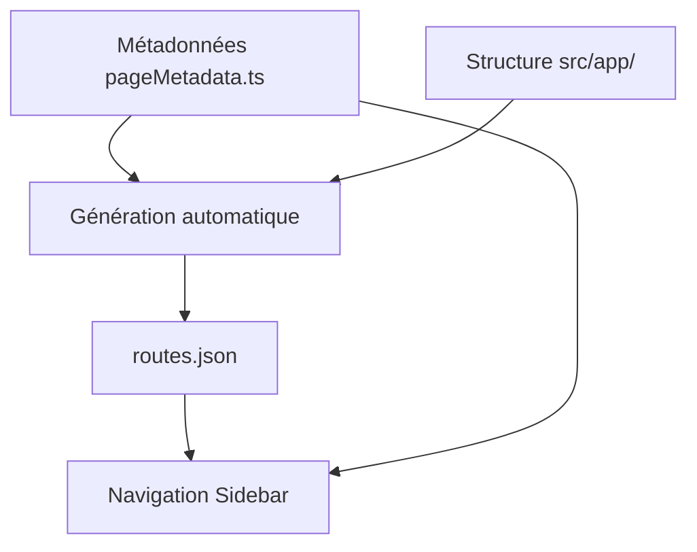

# 🧭 Système de Navigation Automatisé

## 📋 Processus Simplifié d'Ajout de Routes

### ✨ **Méthode Automatique (Recommandée)**

```bash
# Ajouter une route simple
npm run add-route /dashboard

# Ajouter une route avec options complètes
npm run add-route /admin/users --title "Gestion Utilisateurs" --icon "Users" --section "Administration" --order 1
```

**C'est tout !** 🎉 La route sera automatiquement :
- ✅ Créée dans `src/app/`
- ✅ Ajoutée aux métadonnées de navigation
- ✅ Visible dans la sidebar
- ✅ Prête à être personnalisée

### 🛠️ **Méthode Manuelle (Si nécessaire)**

1. **Créer la page** : `src/app/ma-route/page.tsx`
2. **Ajouter les métadonnées** : Dans `src/lib/navigation/pageMetadata.ts`
3. **Régénérer** : `npm run generate-routes`

## 🎯 **Options du Script `add-route`**

| Option | Description | Défaut | Exemple |
|--------|-------------|---------|---------|
| `--title` | Titre dans la navigation | Généré depuis le path | `"Mes Projets"` |
| `--icon` | Icône Lucide React | `Circle` | `FolderOpen`, `Users`, `Settings` |
| `--section` | Section de navigation | `Principal` | `Administration`, `Paramètres` |
| `--order` | Ordre dans la section | `999` | `1`, `2`, `3` |
| `--protected` | Authentification requise | `true` | `true`, `false` |

## 📚 **Exemples d'Usage**

```bash
# Route simple dans la section principale
npm run add-route /tasks --title "Mes Tâches" --icon "CheckSquare"

# Route d'administration
npm run add-route /admin/settings --title "Configuration" --icon "Cog" --section "Administration" --order 1

# Route publique (sans authentification)
npm run add-route /about --title "À Propos" --icon "Info" --protected false

# Route avec ordre spécifique
npm run add-route /reports --title "Rapports" --icon "BarChart" --section "Outils" --order 2
```

## 🏗️ **Architecture du Système**

### **Fichiers Clés**

- **`pageMetadata.ts`** : Source de vérité pour les métadonnées
- **`routes.json`** : Fichier généré automatiquement
- **`routeLoader.ts`** : Logique de chargement intelligente
- **`buildTimeScanner.js`** : Scanner de structure de dossiers
- **`add-route.js`** : Script d'automatisation

### **Flux de Données**



### **Sources de Navigation**

1. **Côté serveur** : Lit `routes.json` (optimal)
2. **Côté client** : Génère depuis `pageMetadata.ts` (fallback)
3. **Fallback ultime** : Navigation minimale hardcodée

## 🎨 **Icônes Disponibles**

Toutes les icônes de [Lucide React](https://lucide.dev/icons/) sont supportées :

```typescript
// Exemples populaires
'Home', 'User', 'Settings', 'Shield', 'FolderOpen', 
'Users', 'BarChart', 'Calendar', 'Mail', 'Bell',
'Search', 'Plus', 'Edit', 'Trash2', 'Download'
```

## 🔧 **Configuration Avancée**

### **Sections Personnalisées**

```typescript
// Dans pageMetadata.ts
'/mon-outil': {
  title: 'Mon Outil',
  icon: 'Wrench',
  section: 'Outils Personnalisés', // Nouvelle section
  order: 1,
  requiresAuth: true,
}
```

### **Routes Imbriquées**

```bash
# Crée automatiquement la hiérarchie
npm run add-route /settings/advanced --title "Avancé" --icon "Sliders"
```

### **Templates Personnalisés**

Le script génère une page de base. Pour des templates spécialisés :

```typescript
// Template API route
export async function GET() {
  return Response.json({ message: 'Hello' });
}

// Template avec hooks personnalisés
import { useMyCustomHook } from '../lib/hooks/useMyCustomHook';
```

## 🚀 **Workflow de Développement**

### **Développement d'une Nouvelle Fonctionnalité**

```bash
# 1. Créer la route
npm run add-route /feature --title "Ma Fonctionnalité" --icon "Zap"

# 2. Développer
code src/app/feature/page.tsx

# 3. Tester
npm run dev
# → http://localhost:3000/feature

# 4. La route apparaît automatiquement dans la sidebar
```

### **Réorganisation**

```bash
# Modifier les métadonnées
code src/lib/navigation/pageMetadata.ts

# Régénérer
npm run generate-routes
```

## 🐛 **Dépannage**

### **Route Manquante dans la Sidebar**

1. Vérifier les métadonnées : `src/lib/navigation/pageMetadata.ts`
2. Régénérer : `npm run generate-routes`
3. Redémarrer le serveur : `npm run dev`

### **Erreur de Compilation**

```bash
# Vérifier la syntaxe
npm run lint

# Reconstruire
npm run build
```

### **Debug du Système de Navigation**

```javascript
// Dans la console du navigateur
console.log(localStorage.getItem('navigation-debug'));
```

## 📈 **Évolutions Futures**

- [ ] Interface graphique pour gérer les routes
- [ ] Templates de pages spécialisées
- [ ] Import/export de configurations
- [ ] Validation automatique des métadonnées
- [ ] Hot-reload des métadonnées en développement

---

**💡 Conseil** : Utilisez toujours le script `npm run add-route` pour une expérience optimale et éviter les erreurs manuelles ! 